# BÁO CÁO THIẾT KẾ LẠI & KIỂM THỬ TRỰC QUAN LANDING PAGE NUTRITRACKAI

- **Dự án**: Website hỗ trợ quản lý cân nặng và tư vấn dinh dưỡng cá nhân hóa tích hợp AI (`NutriTrackAI`)
- **Nhánh phát triển**: `feature/landing-page-ui-redesign`
- **Checkpoint sao lưu gốc**: `667c1ba` (`667c1bacc039a23541c31ad098cfd66de7f491e5` trên nhánh `main`)
- **Phương pháp & Tiêu chuẩn áp dụng**: Skill `ui-ux-pro-max` — *Modern HealthTech SaaS, Premium Minimalism, Editorial Food Photography, WCAG 2.2 AA*
- **Trạng thái tích hợp**: Giữ độc lập trên nhánh `feature/landing-page-ui-redesign` (chưa merge vào `main`, chưa push lên remote)

---

## Mục lục

1. [Quản lý Phiên bản & Checkpoint Git An toàn](#1-quản-lý-phiên-bản--checkpoint-git-an-toàn)
2. [Hệ thống Thiết kế (Design System)](#2-hệ-thống-thiết-kế-design-system)
3. [Chi tiết Thiết kế & Ảnh chụp từng Section (Desktop 1440px)](#3-chi-tiết-thiết-kế--ảnh-chụp-từng-section-desktop-1440px)
4. [Thiết kế Responsive & Ảnh chụp Giao diện Mobile (390px)](#4-thiết-kế-responsive--ảnh-chụp-giao-diện-mobile-390px)
5. [Ảnh chụp Toàn bộ Trang (Full-Page 1440px & 390px)](#5-ảnh-chụp-toàn-bộ-trang-full-page-1440px--390px)
6. [Danh sách File chỉnh sửa, Tối ưu Hiệu năng & Bảo toàn Nghiệp vụ](#6-danh-sách-file-chỉnh-sửa-tối-ưu-hiệu-năng--bảo-toàn-nghiệp-vụ)
7. [Kết quả Kiểm thử Tự động, Tương tác & Bảng Đối chiếu Master Prompt](#7-kết-quả-kiểm-thử-tự-động-tương-tác--bảng-đối-chiếu-master-prompt)

---

## 1. Quản lý Phiên bản & Checkpoint Git An toàn

Trước khi thực hiện bất kỳ chỉnh sửa giao diện nào, dự án đã được rà soát [`.gitignore`](../.gitignore), kiểm tra toàn bộ file cấu hình ([`appsettings.json`](../appsettings.json), [`appsettings.Development.json`](../appsettings.Development.json)) để đảm bảo không lộ mật khẩu, API key hoặc dữ liệu nhạy cảm, sau đó thiết lập mốc sao lưu nguyên trạng và tách nhánh làm việc riêng.

### Lịch sử Commit trên nhánh `feature/landing-page-ui-redesign`

| Thứ tự | Mã Commit | Nội dung thay đổi |
| :---: | :---: | :--- |
| **Gốc** | `667c1ba` | `checkpoint: backup NutriTrackAI before landing page redesign` *(nhánh `main` giữ nguyên tại mốc này)* |
| **1** | `3d6ed0a` | `feat(landing): establish design system and upgrade navbar, hero, and intro sections` |
| **2** | `dbce22e` | `feat(landing): redesign workflow storytelling and editorial meal plan showcase` |
| **3** | `13483be` | `feat(landing): refine safety cards, faq accordion, medical disclaimer, and dark footer` |
| **4** | `2ceb645` | `style(landing): polish metric card proportions, meal descriptions, and mobile anchor scroll` |

### Hướng dẫn khôi phục về phiên bản Checkpoint an toàn (khi cần)

```powershell
# Cất tạm mọi thay đổi chưa lưu (nếu có) và quay về nhánh gốc tại checkpoint 667c1ba
git stash push -u -m "wip: luu tam thay doi giao dien"
git switch main
```

---

## 2. Hệ thống Thiết kế (Design System)

Toàn bộ token giao diện Landing Page được đóng gói riêng dưới phạm vi `.home-landing` trong [`wwwroot/css/site.css`](../wwwroot/css/site.css) để không làm ảnh hưởng đến Dashboard hay các trang chức năng bên trong ứng dụng.

### 2.1. Bảng màu & Độ tương phản (WCAG 2.2 AA)

| Vai trò | Mã màu | Biến CSS | Mục đích sử dụng |
| :--- | :---: | :--- | :--- |
| **Primary Emerald** | `#008F68` | `--home-emerald` | Điểm nhấn thương hiệu, biểu tượng, con số calo lớn, nút CTA trên nền tối |
| **Action Emerald** | `#007A58` | `--home-action` | Nút hành động chính chữ trắng, liên kết văn bản trên nền sáng (tương phản `> 5.3:1`) |
| **Deep Forest** | `#073D32` | `--home-forest` | Tiêu đề section (`h2`), tiêu đề thẻ (`h3`), chữ nhấn quan trọng (tương phản `11.9:1`) |
| **Dark Text** | `#102C27` | `--home-ink` | Văn bản điều hướng và nhãn thông tin chính |
| **Muted Text** | `#52665F` | `--home-muted` | Đoạn văn mô tả, chú thích phụ (đạt chuẩn AA ngay cả trên nền xanh mint) |
| **Soft Mint** | `#F2FAF6` | `--home-mint` | Nền section *Cách sử dụng*, thẻ chỉ số phụ, hộp nhấn thông tin |
| **Light Green** | `#E6F6EC` | `--home-mint-strong` | Nền huy hiệu (eyebrow pill), ô chứa icon |
| **Neutral Sage** | `#F5F8F6` | `--home-neutral` | Nền trung tính dịu cho section *Khoa học và an toàn* |
| **Border** | `#DFE9E3` | `--home-rule` | Đường viền mảnh cho Card và Accordion |
| **Warning Surface** | `#FFFDF4` / `#F2DE9B` | `--home-warning-bg` | Hộp Cảnh báo y tế bắt buộc |
| **Dark Navy Footer** | `#101828` | `--home-footer-bg` | Chân trang tối màu chuyên nghiệp |

### 2.2. Typography & Nhịp điệu Khoảng cách

- **Phông chữ**: `Be Vietnam Pro` tự lưu trữ cục bộ (`400`, `500`, `600`, `700`, `800`), tối ưu dấu tiếng Việt.
- **Thang chữ linh hoạt (`clamp()`)**:
  - Hero Title: `clamp(2.35rem, 4.7vw, 4.45rem)` (`line-height: 1.1`)
  - Section Title (`h2`): `clamp(1.9rem, 3.1vw, 2.75rem)` (`line-height: 1.15`)
  - Card Title (`h3`): `1.08rem – 1.45rem` (`font-weight: 750–800`)
  - Body Copy: `0.96rem – 1.05rem` (`line-height: 1.6 – 1.68`)
- **Chuỗi nền liên hoàn không đứt gãy**:
  `Navbar trắng cố định` → `Hero ảnh nền tối tràn viền` → `Giới thiệu (Trắng)` → `Cách sử dụng (Soft Mint #F2FAF6)` → `Thực đơn mẫu (Trắng)` → `Khoa học & An toàn (Neutral Sage #F5F8F6)` → `FAQ (Trắng)` → `Cảnh báo y tế (Vàng kem #FFFDF6)` → `Footer (Navy #101828)`.

---

## 3. Chi tiết Thiết kế & Ảnh chụp từng Section (Desktop `1440px`)

### 3.1. Navbar & Hero Banner (Full-Width Cinematic Food Photography)

- **Navbar**: Nằm cố định ở đỉnh trang (`y = 0`, `min-height: 72px`), bổ sung skip-link bàn phím (`Chuyển đến nội dung chính`), giữ nguyên toàn bộ liên kết điều hướng, trạng thái đăng nhập, quyền Admin và dropdown hồ sơ.
- **Hero Slideshow**: Tràn viền `100%` chiều ngang viewport, giữ nguyên tự động chuyển cảnh, 3 chấm chọn trang chiếu và nút Tạm dừng/Tiếp tục trong thanh điều khiển kính mờ ở trung tâm đáy.
  - **Slide 1 & Slide 2**: Bố cục tiêu đề trắng cân giữa cùng 2 nút hành động `Bắt Đầu Ngay` (`/Account/Register`) và `Tư Vấn AI` (`/Chat/Index`).
  - **Slide 3 (*"ĐỒNG HÀNH CÙNG SỨC KHỎE CỦA BẠN"*)**: Căn lề trái trên vùng đá đen mở rộng, tôn trọn vẹn các bát món ăn healthy bên phải mà không che khuất chủ thể.

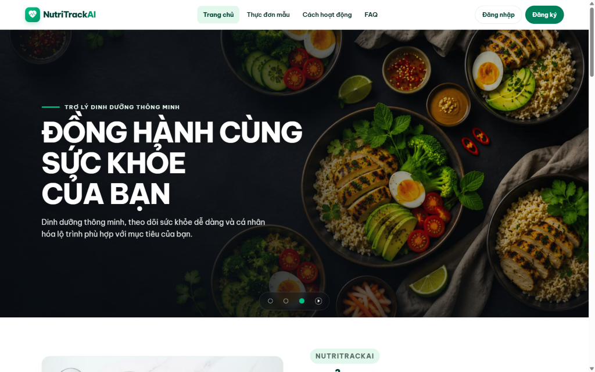

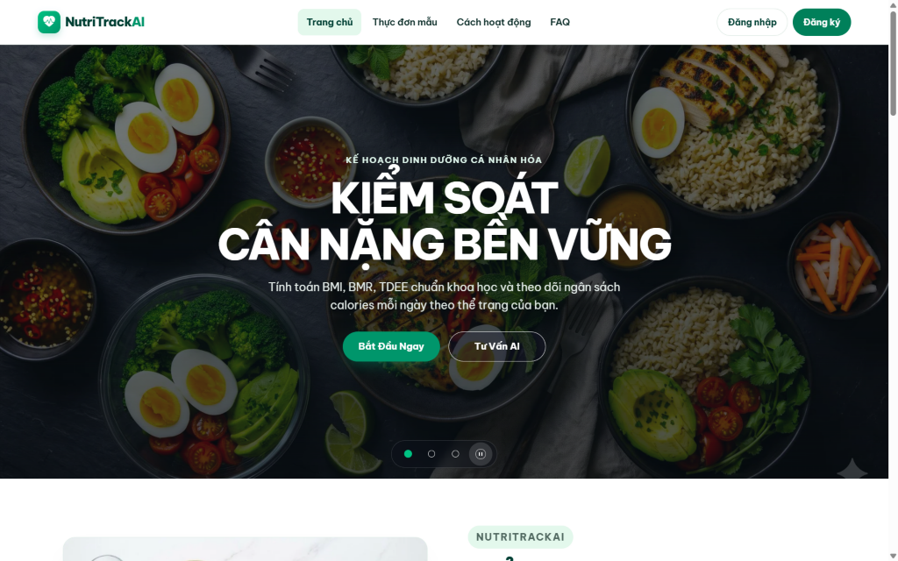

---

### 3.2. Section Giới thiệu: "Hiểu bữa ăn, theo dõi mục tiêu"

- Bố cục hai cột cân bằng theo trục dọc, loại bỏ hoàn toàn khoảng trắng dư thừa bên dưới.
- **Cột trái**: Ảnh bữa ăn healthy chụp từ trên xuống bo góc `20px`, sắc nét, **không bị bất kỳ bảng hay thẻ nào đè che khuất**.
- **Cột phải**: Huy hiệu `NUTRITRACKAI`, tiêu đề lớn, mô tả súc tích, thanh nhấn cá nhân hóa và hàng 4 thẻ chỉ số đồng bộ chiều cao (`Chỉ số BMI / BMR / TDEE / Cân bằng calo ngày`, `202+ Món ăn trong danh mục`, `10+ Bài tập có chỉ số MET`, `Theo hồ sơ — Lọc dị ứng an toàn`), sử dụng số liệu thực trực tiếp từ CSDL.

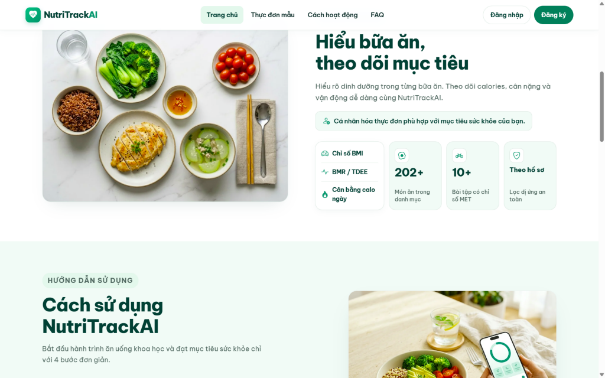

---

### 3.3. Section "Cách sử dụng NutriTrackAI" (`#cach-su-dung`)

- Thiết kế lại hoàn toàn theo phong cách **Lifestyle Product Storytelling** trên nền Soft Mint `#F2FAF6`.
- **Cột trái**: Nhãn `HƯỚNG DẪN SỬ DỤNG`, tiêu đề, mô tả mở đầu và 4 bước đánh số `01.` – `04.` kèm biểu tượng đồng bộ và đường kẻ mảnh kết nối trực quan.
- **Cột phải**: Ảnh biên tập sáng tự nhiên thể hiện người dùng cầm điện thoại theo dõi dinh dưỡng bên cạnh bữa ăn lành mạnh (giao diện trên màn hình điện thoại dùng hình khối tối giản, không chứa chữ thừa hay dữ liệu cá nhân giả).
- **Tuân thủ yêu cầu đặc biệt**: **Không có nút `"Xem tổng quan"`, `"Bắt đầu ngay"` hay `"Tạo tài khoản"`** — khu vực này giữ đúng vai trò giới thiệu quy trình sử dụng.

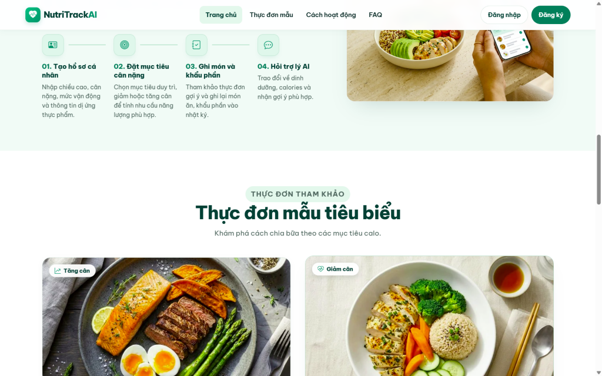

---

### 3.4. Section "Thực đơn mẫu tiêu biểu" (`#thuc-don-mau`)

- Khắc phục triệt để hạn chế cũ (2 thẻ nhỏ nằm lọt thỏm trong lưới 3 cột gây trống trải hai bên): hệ thống lưới tự động chia **2 cột rộng cân đối** (`~595px` mỗi thẻ trên màn hình `1440px`) khi có 2 thực đơn công khai và sẵn sàng mở rộng thành 3 cột khi dữ liệu thực tế có từ 3 thực đơn.
- Ảnh món ăn lớn tỷ lệ `16:10` chiếm phần nổi bật phía trên thẻ, kèm nhãn mục tiêu (`Tăng cân`, `Giảm cân`) và nhãn `Ảnh minh họa` minh bạch.
- Phần nội dung trình bày rõ tên thực đơn, mức năng lượng màu xanh emerald nổi bật (`2.200 kcal`, `1.500 kcal`), mô tả đầy đủ không bị cắt chữ, số món ăn trong ngày, ghi chú `Đối chiếu dị ứng theo hồ sơ` và liên kết `Xem chi tiết →`.

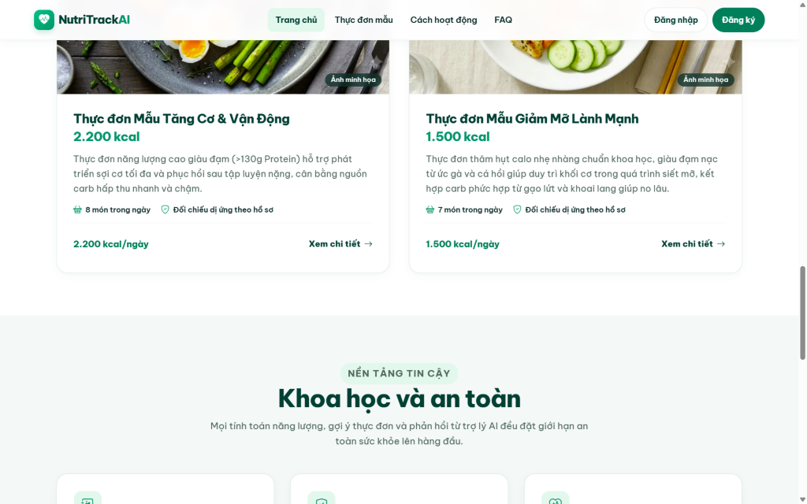

---

### 3.5. Section "Khoa học và an toàn" & "Câu hỏi thường gặp" (`#faq-section`)

- **Khoa học và an toàn**: Đặt trên nền trung tính nhẹ `#F5F8F6` với 3 thẻ trắng cân đối (*Dữ liệu Viện Dinh dưỡng & USDA*, *Sàng lọc dị ứng theo hồ sơ*, *Bảo vệ sức khỏe*), giữ nguyên giới hạn an toàn và không đưa ra tuyên bố y tế phóng đại.
- **Câu hỏi thường gặp (FAQ)**: Bố cục 2 cột rõ ràng; bên trái gồm tiêu đề, lời dẫn và nút liên kết `Xem tất cả Kiến thức & FAQ →`; bên phải là danh sách Accordion bo góc với nút mũi tên xoay mượt, viền nổi bật khi mở, hỗ trợ điều khiển bàn phím và hiển thị trọn vẹn câu trả lời.

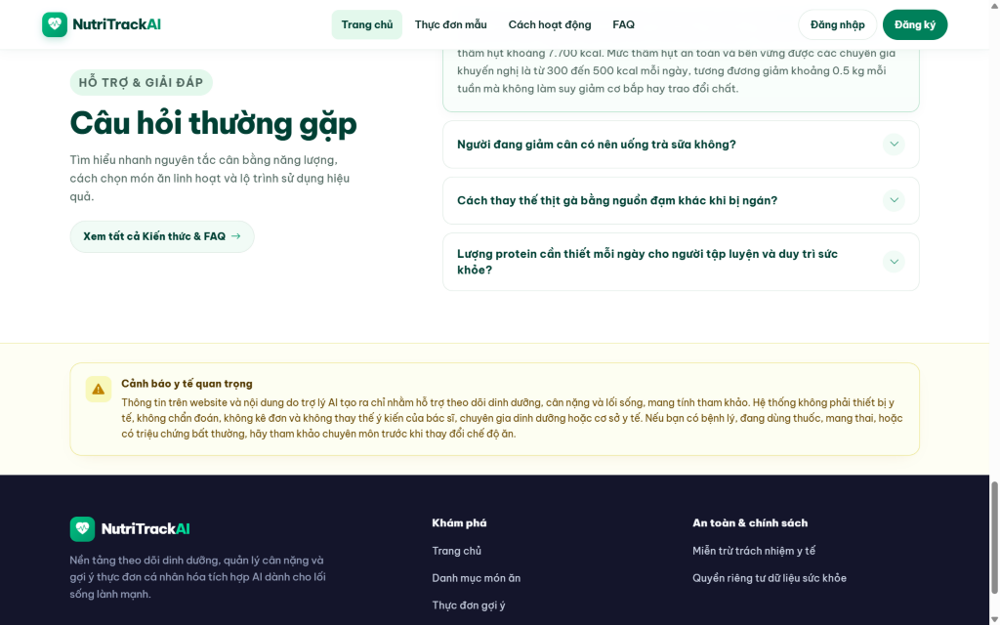

---

### 3.6. Cảnh báo Y tế Bắt buộc & Footer Tối màu

- **Cảnh báo y tế (`#medical-disclaimer`)**: Nằm trong dải nền vàng kem dịu `#FFFDF6` ngay phía trên Footer (loại bỏ khoảng hở trắng `mb-4` cũ), giữ **nguyên văn 100%** nội dung miễn trừ trách nhiệm y tế bắt buộc của dự án.
- **Footer (`#101828`)**: Nền Navy tối sang trọng, bố cục 3 cột cân đối gồm thương hiệu `NutriTrackAI`, nhóm liên kết *Khám phá* (`Trang chủ`, `Danh mục món ăn`, `Thực đơn gợi ý`, `Kiến thức & FAQ`) và *An toàn & chính sách* (`Miễn trừ trách nhiệm y tế`, `Quyền riêng tư dữ liệu sức khỏe`).

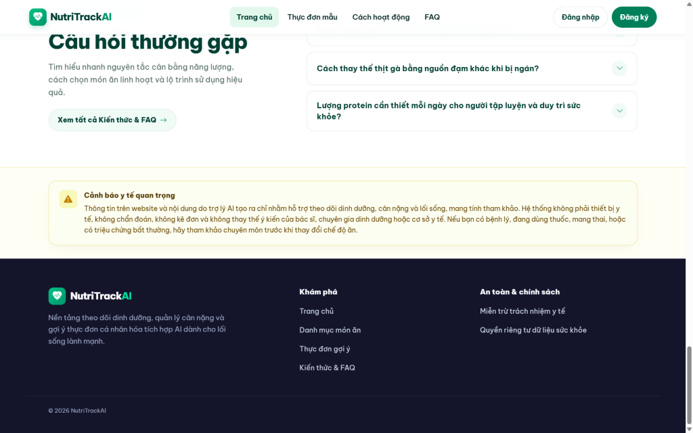

---

## 4. Thiết kế Responsive & Ảnh chụp Giao diện Mobile (`390px`)

### 4.1. Kiểm tra Đa độ phân giải (9 kích thước tiêu chuẩn)

Đã kiểm tra thực tế trên trình duyệt tại `http://localhost:5188` qua 9 mức viewport từ Mobile đến Desktop lớn — tất cả đều đạt `scrollWidth <= clientWidth` (**không phát sinh thanh cuộn ngang**):

| Nhóm thiết bị | Viewport kiểm tra | `clientWidth` | `scrollWidth` | Trạng thái tràn ngang | Bố cục hiển thị thực tế |
| :--- | :---: | :---: | :---: | :---: | :--- |
| **Desktop lớn** | `1920 × 1080` | `1904.8 px` | `1904.8 px` | Không (`0 px`) | Container `1320px` cân giữa, Hero tràn viền `100%` |
| **Desktop chuẩn** | `1440 × 900` | `1424.8 px` | `1424.8 px` | Không (`0 px`) | 2 cột chuẩn, 4 bước nối ngang, 2 thẻ thực đơn lớn |
| **Laptop phổ thông** | `1366 × 768` | `1351.2 px` | `1351.2 px` | Không (`0 px`) | Cân đối, không ép chữ trong thẻ chỉ số và bước hướng dẫn |
| **Laptop gọn** | `1280 × 800` | `1264.8 px` | `1264.8 px` | Không (`0 px`) | Giữ nguyên bố cục 2 cột thoáng, Navbar một hàng |
| **Tablet ngang** | `1024 × 768` | `1008.8 px` | `1008.8 px` | Không (`0 px`) | 4 bước tự động chuyển sang lưới `2 × 2` dễ đọc |
| **Tablet dọc** | `768 × 1024` | `752.8 px` | `752.8 px` | Không (`0 px`) | Menu Hamburger, Thực đơn 2 cột, Giới thiệu & Cách dùng xếp dọc |
| **Mobile lớn** | `430 × 932` | `415.2 px` | `415.2 px` | Không (`0 px`) | 1 cột ưu tiên nội dung, vùng chạm nút `>= 44px` |
| **Mobile chuẩn** | `390 × 844` | `375.2 px` | `375.2 px` | Không (`0 px`) | Timeline 4 bước nối dọc, mô tả thực đơn hiển thị đầy đủ |
| **Mobile nhỏ** | `375 × 812` | `360.0 px` | `360.0 px` | Không (`0 px`) | Chữ và thẻ co giãn gọn, không cắt chữ hoặc che ảnh |

### 4.2. Ảnh chụp Chi tiết trên Mobile (`390 × 844`)

| Hero & Navbar thu gọn (`390px`) | Menu Hamburger mở (`390px`) |
| :---: | :---: |
| 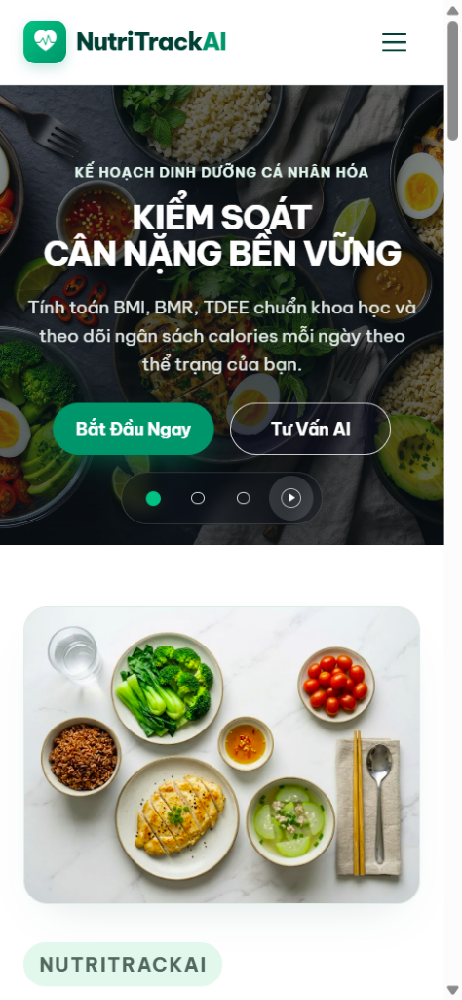 | 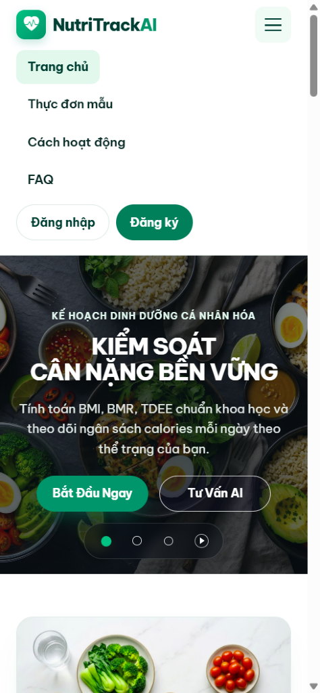 |

| Cách sử dụng — Timeline dọc (`390px`) | Thẻ Thực đơn mẫu hiển thị trọn mô tả (`390px`) |
| :---: | :---: |
| 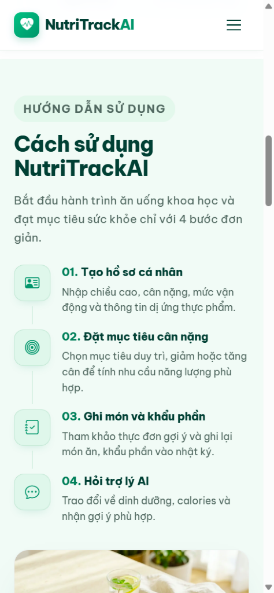 | 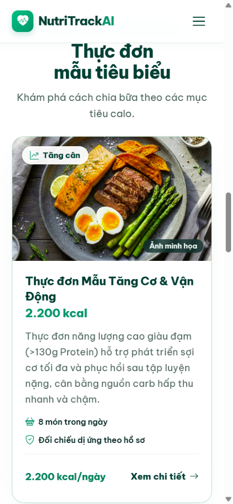 |

---

## 5. Ảnh chụp Toàn bộ Trang (Full-Page `1440px` & `390px`)

### 5.1. Toàn bộ Landing Page ở độ rộng `1440px` (`1440 × 4797 px`)

- Đường dẫn file: [`docs/screenshots/landing-page-redesign/landing-1440px-full.png`](./screenshots/landing-page-redesign/landing-1440px-full.png)

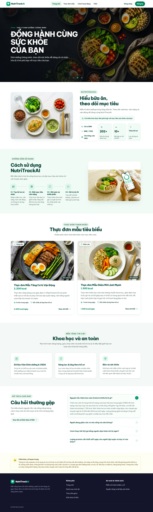

---

### 5.2. Toàn bộ Landing Page ở độ rộng `390px` (`390 × 7064 px`)

- Đường dẫn file: [`docs/screenshots/landing-page-redesign/landing-390px-full.png`](./screenshots/landing-page-redesign/landing-390px-full.png)

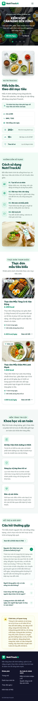

---

## 6. Danh sách File chỉnh sửa, Tối ưu Hiệu năng & Bảo toàn Nghiệp vụ

### 6.1. Các file mã nguồn đã cập nhật

1. [`Views/Home/Index.cshtml`](../Views/Home/Index.cshtml):
   - Nâng cấp cấu trúc HTML ngữ nghĩa cho Hero, Giới thiệu, Cách sử dụng, Thực đơn mẫu, Khoa học & An toàn và FAQ.
   - Bổ sung thẻ `<picture>` ưu tiên định dạng `.webp` kèm fallback `.jpg`/`.png` gốc.
   - Xử lý cuộn mượt có `event.preventDefault()` khi chọn liên kết neo (`#cach-su-dung`, `#thuc-don-mau`, `#faq-section`) từ menu thu gọn trên Mobile.
2. [`Views/Shared/_Layout.cshtml`](../Views/Shared/_Layout.cshtml):
   - Thêm liên kết `Chuyển đến nội dung chính` (`#main-content`) hỗ trợ điều hướng bàn phím.
   - Khử trùng lặp `sticky-top` trên `<nav>` khi ở trang chủ và thiết kế dải Cảnh báo y tế nối liền Footer tối màu riêng cho `isHomeLanding` (giữ nguyên 100% chân trang của mọi màn hình khác).
3. [`wwwroot/css/site.css`](../wwwroot/css/site.css):
   - Xây dựng hệ thống biến Design System, component styles, hiệu ứng chuyển động tinh tế (`180–220ms`), hỗ trợ `prefers-reduced-motion: reduce` và responsive đa thiết bị.

### 6.2. Tài nguyên hình ảnh bổ sung & Tối ưu dung lượng

- Ảnh minh họa mới cho phần *Cách sử dụng*: [`workflow-lifestyle.jpg`](../wwwroot/images/home/workflow-lifestyle.jpg), [`workflow-lifestyle.webp`](../wwwroot/images/home/workflow-lifestyle.webp).
- Bộ ảnh `.webp` tối ưu tốc độ tải (đặc biệt giảm dung lượng ảnh Hero Slide 3 từ **`2.780 KB`** xuống **`240 KB`** — giảm hơn **11 lần** mà vẫn giữ độ nét cao):
  - [`wwwroot/images/hero-1.webp`](../wwwroot/images/hero-1.webp), [`wwwroot/images/hero-2.webp`](../wwwroot/images/hero-2.webp)
  - [`wwwroot/images/home/hero-3-slate.webp`](../wwwroot/images/home/hero-3-slate.webp)
  - [`wwwroot/images/home/about-healthy.webp`](../wwwroot/images/home/about-healthy.webp)
  - [`wwwroot/images/home/plan-1.webp`](../wwwroot/images/home/plan-1.webp), [`wwwroot/images/home/plan-2.webp`](../wwwroot/images/home/plan-2.webp), [`wwwroot/images/home/plan-3.webp`](../wwwroot/images/home/plan-3.webp)

### 6.3. Các thành phần được giữ nguyên 100%

- Toàn bộ Backend Controllers ([`HomeController.cs`](../Controllers/HomeController.cs), [`MealPlanController.cs`](../Controllers/MealPlanController.cs)...), ViewModels ([`HomeIndexViewModel.cs`](../Models/ViewModels/HomeIndexViewModel.cs)), Services, Filters, Migrations và Database Schema.
- Toàn bộ thuật toán tính BMI, BMR, TDEE, ngân sách calo, kiểm tra dị ứng, xác thực ASP.NET Core Identity và bộ lọc an toàn y tế của Chatbot AI.

---

## 7. Kết quả Kiểm thử Tự động, Tương tác & Bảng Đối chiếu Master Prompt

### 7.1. Kiểm thử Tự động (`NutriTrackAI.Tests`)

```powershell
dotnet test NutriTrackAI.Tests/NutriTrackAI.Tests.csproj -c Release --no-restore --nologo -v minimal
```

- **Kết quả**: **243 / 243 bài kiểm thử đạt (`Failed: 0, Passed: 243, Skipped: 0`)**, bao gồm các bài kiểm tra cấu trúc Hero Slideshow (`HomeHero_ShowsRequestedActionsOnFirstTwoSlides`), định danh trang hiện hành trên Navbar (`MainNavigation_IdentifiesCurrentPageOrSection`), bảo mật phân quyền và toàn bộ nghiệp vụ dinh dưỡng.

### 7.2. Bảng Đối chiếu Nghiệm thu Cuối cùng

| STT | Hạng mục kiểm tra theo yêu cầu | Kết quả xác minh thực tế | Trạng thái |
| :-: | :--- | :--- | :---: |
| 1 | Ứng dụng chạy code mới nhất trên `feature/landing-page-ui-redesign` | Đã build `0 Warning, 0 Error` và kiểm thử trực tiếp trên bản chạy thực tế | **Đạt** |
| 2 | Ảnh chụp toàn bộ Landing Page ở độ rộng `1440px` | Đã xuất file `1440 × 4797 px` tại [`landing-1440px-full.png`](./screenshots/landing-page-redesign/landing-1440px-full.png) | **Đạt** |
| 3 | Ảnh chụp toàn bộ Landing Page ở độ rộng `390px` | Đã xuất file `390 × 7064 px` tại [`landing-390px-full.png`](./screenshots/landing-page-redesign/landing-390px-full.png) | **Đạt** |
| 4 | Các section nối liền tự nhiên, không có khoảng trắng thừa | Nhịp nền chuyển tiếp liền mạch từ Hero đến Footer, không còn khoảng trắng hở trước chân trang | **Đạt** |
| 5 | Hình ảnh healthy sắc nét, không bị méo hoặc crop sai | Tất cả ảnh dùng `object-fit: cover` đúng tâm chủ thể, có `width`/`height` và `aspect-ratio` chống nhảy bố cục | **Đạt** |
| 6 | Section *"Cách sử dụng"* không còn nút CTA thừa | Đã gỡ bỏ hoàn toàn nút *"Xem tổng quan"* / *"Tạo tài khoản"*, giữ thuần vai trò giới thiệu 4 bước | **Đạt** |
| 7 | Chức năng & liên kết quan trọng hoạt động đầy đủ | Slideshow (chấm chuyển + tạm dừng), menu Mobile, FAQ Accordion, link `/Food`, `/Home/Articles`, `/MealPlan`, `/Account/Login`, `/Account/Register` đều hoạt động với `0` lỗi Console | **Đạt** |
| 8 | Bảo toàn checkpoint `667c1ba` và các commit đã tạo | Nhánh `main` giữ nguyên tại `667c1ba`, chưa merge, chưa push lên remote | **Đạt** |
