# BÁO CÁO TỔNG HỢP CÔNG VIỆC: THIẾT KẾ LẠI, TINH CHỈNH THẨM MỸ & NGHIỆM THU LANDING PAGE NUTRITRACKAI

- **Dự án**: Website hỗ trợ quản lý cân nặng và tư vấn dinh dưỡng cá nhân hóa tích hợp AI (`NutriTrackAI`)
- **Nhánh phát triển**: `feature/landing-page-ui-redesign`
- **Checkpoint sao lưu gốc**: `667c1ba` (`667c1bacc039a23541c31ad098cfd66de7f491e5` trên nhánh `main`)
- **Phương pháp & Tiêu chuẩn áp dụng**: Skill `ui-ux-pro-max` — *Modern HealthTech SaaS, Editorial Food Photography, Refined Minimalism, WCAG 2.2 AA*
- **Trạng thái tích hợp**: Hoàn tất kiểm tra nghiệm thu trên nhánh `feature/landing-page-ui-redesign` (chưa merge vào `main`, chưa push lên remote, bảo toàn nguyên vẹn toàn bộ Backend, CSDL, API và thuật toán nghiệp vụ)

---

## Mục lục

1. [Tổng quan Quy trình 5 Giai đoạn & Lịch sử Commit Git](#1-tổng-quan-quy-trình-5-giai-đoạn--lịch-sử-commit-git)
2. [Hệ thống Thiết kế (Design System & Kiến trúc CSS)](#2-hệ-thống-thiết-kế-design-system--kiến-trúc-css)
3. [Chi tiết Hạng mục Triển khai & Ảnh chụp Nghiệm thu (Desktop 1440px)](#3-chi-tiết-hạng-mục-triển-khai--ảnh-chụp-nghiệm-thu-desktop-1440px)
4. [Thiết kế Responsive & Ảnh chụp Giao diện Mobile (390px)](#4-thiết-kế-responsive--ảnh-chụp-giao-diện-mobile-390px)
5. [Ảnh chụp Toàn bộ Trang (Full-Page 1440px & 390px)](#5-ảnh-chụp-toàn-bộ-trang-full-page-1440px--390px)
6. [Tổng hợp Danh sách File Thay đổi & Tối ưu Tài nguyên](#6-tổng-hợp-danh-sách-file-thay-đổi--tối-ưu-tài-nguyên)
7. [Kết quả Kiểm thử Nghiệm thu Cuối cùng (Build, Unit Tests & Live Browser QA)](#7-kết-quả-kiểm-thử-nghiệm-thu-cuối-cùng-build-unit-tests--live-browser-qa)

---

## 1. Tổng quan Quy trình 5 Giai đoạn & Lịch sử Commit Git

Toàn bộ quá trình nâng cấp Landing Page được thực hiện theo quy trình quản lý phiên bản an toàn, tách bạch từng nhóm thay đổi thành các commit độc lập có thể kiểm chứng hoặc hoàn tác bất cứ lúc nào:

1. **Giai đoạn 1 — Thiết lập Checkpoint Git An toàn**: Rà soát [`.gitignore`](../.gitignore), kiểm tra các tệp cấu hình nhạy cảm, lưu mốc nguyên trạng `667c1ba` trên `main` và tách nhánh riêng `feature/landing-page-ui-redesign`.
2. **Giai đoạn 2 — Thiết kế lại Kiến trúc Giao diện (Master Prompt Redesign)**: Xây dựng hệ thống token `.home-landing`, nâng cấp toàn diện từ Navbar, Hero Slideshow 3 trang chiếu, Giới thiệu, Quy trình 4 bước, Thực đơn mẫu, Khoa học & An toàn, FAQ đến Cảnh báo y tế và Footer tối màu; nén bộ ảnh `.webp`.
3. **Giai đoạn 3 — Tinh chỉnh Thẩm mỹ Cuối cùng (Art Director Final Polish)**: Giảm mật độ chữ trung tâm trên Hero để giữ trọn không gian ảnh món ăn, loại bỏ chồng lớp nền xanh (*green-on-green*) ở phần Giới thiệu, nâng cấp phần *Cách sử dụng* lên bố cục biên tập 2 tầng, khử lặp thông tin calo trên thẻ Thực đơn mẫu và đưa Cảnh báo y tế về khung thông báo lâm sàng đơn lớp trang nhã.
4. **Giai đoạn 4 — Chuẩn hóa Thư viện Ảnh Nghiệm thu**: Lưu bộ 14 ảnh chụp màn hình sau tinh chỉnh vào [`wwwroot/images/landingpage`](../wwwroot/images/landingpage) và dọn sạch các ảnh chụp cũ trước tinh chỉnh trong thư mục này.
5. **Giai đoạn 5 — Kiểm tra Nghiệm thu Cuối cùng (Final Acceptance QA)**: Xác minh thực tế Navbar sticky khi cuộn, gia cố skip-link bàn phím chỉ hiện khi `:focus-visible`, cập nhật nút `"Bắt Đầu Ngay"` trên Hero tự động điều hướng sang Dashboard khi người dùng đã đăng nhập (`/Dashboard` hoặc `/Admin/Dashboard`) và chạy toàn bộ `243/243` bài kiểm thử tự động.

### Bảng chi tiết toàn bộ Commit Git

| STT | Mã Commit | Phân loại | Nội dung thực hiện chi tiết |
| :-: | :---: | :---: | :--- |
| **Gốc** | `667c1ba` | `checkpoint` | `checkpoint: backup NutriTrackAI before landing page redesign` — Mốc sao lưu gốc trên nhánh `main`. |
| **1** | `3d6ed0a` | `feat(landing)` | `establish design system and upgrade navbar, hero, and intro sections` — Khởi tạo Design System `.home-landing`, nâng cấp Navbar sticky, skip-link, Hero 3 slide tràn viền, phần Giới thiệu và ảnh `.webp`. |
| **2** | `dbce22e` | `feat(landing)` | `redesign workflow storytelling and editorial meal plan showcase` — Thiết kế phần *Cách sử dụng* (bỏ hoàn toàn nút CTA thừa), bổ sung ảnh `workflow-lifestyle` và lưới *Thực đơn mẫu* `16:10`. |
| **3** | `13483be` | `feat(landing)` | `refine safety cards, faq accordion, medical disclaimer, and dark footer` — Hoàn thiện 3 thẻ *Khoa học & An toàn*, FAQ Accordion, dải *Cảnh báo y tế* nguyên văn và Footer `#101828`. |
| **4** | `2ceb645` | `style(landing)` | `polish metric card proportions, meal descriptions, and mobile anchor scroll` — Cân chỉnh tỷ lệ thẻ chỉ số, hiển thị trọn mô tả thực đơn trên Mobile và xử lý cuộn neo khi đóng menu thu gọn. |
| **5** | `3a3737a` | `docs(landing)` | `add comprehensive redesign and visual QA report with screenshots` — Khởi tạo tài liệu báo cáo và ảnh chụp đợt 1 trong `docs/`. |
| **6** | `fa50324` | `chore(landing)` | `save captured QA screenshots into wwwroot/images/landingpage` — Sao lưu ảnh chụp đợt 1 vào `wwwroot/images/landingpage`. |
| **7** | `551658c` | `style(landing)` | `final premium art direction polish` — Tinh chỉnh thẩm mỹ cấp Art Director cho toàn bộ 7 khu vực trên Landing Page (`Index.cshtml`, `site.css`). |
| **8** | `5f538c0` | `chore(landing)` | `save post-polish QA screenshots into wwwroot/images/landingpage` — Đưa 14 ảnh chụp màn hình sau tinh chỉnh vào `wwwroot/images/landingpage`. |
| **9** | `e07be34` | `chore(landing)` | `remove pre-polish screenshots from wwwroot/images/landingpage` — Xóa 15 ảnh chụp cũ trong `wwwroot/images/landingpage` theo yêu cầu. |
| **10** | `de3b0db` | `fix(landing)` | `route signed-in hero CTA to dashboard and harden skip-link focus` — Điều hướng nút `"Bắt Đầu Ngay"` sang Dashboard khi đã đăng nhập, gia cố `.home-skip-link` và cập nhật bài test `WorkflowTests.cs`. |

### Lệnh thao tác Git tham khảo (khi cần nghiệm thu hợp nhất hoặc khôi phục)

```powershell
# 1. Quay về trạng thái gốc trước khi làm Landing Page (nếu cần đối chiếu):
git switch main

# 2. Hợp nhất chính thức nhánh giao diện vào main (chỉ chạy khi bạn quyết định sử dụng chính thức):
git switch main
git merge --no-ff feature/landing-page-ui-redesign -m "merge: integrate redesigned NutriTrackAI landing page"
```

---

## 2. Hệ thống Thiết kế (Design System & Kiến trúc CSS)

Toàn bộ quy tắc giao diện mới được cô lập trong phạm vi `.home-landing` tại [`wwwroot/css/site.css`](../wwwroot/css/site.css), không gây xung đột với Dashboard, Nhật ký bữa ăn, Chatbot AI hay khu vực Quản trị Admin.

- **Bảng màu thương hiệu đạt chuẩn tương phản WCAG 2.2 AA**:
  - `--home-emerald: #008F68` (nhấn thương hiệu, con số năng lượng, thanh chỉ báo)
  - `--home-action: #007A58` / `--home-action-hover: #065A43` (nút hành động chính chữ trắng, tương phản `> 5.3:1`)
  - `--home-forest: #073D32` (tiêu đề chính `h2`, tiêu đề thẻ `h3`, tương phản `11.9:1`)
  - `--home-ink: #102C27` & `--home-muted: #52665F` (nội dung văn bản và mô tả phụ)
  - Chuỗi nền chuyển tiếp liền mạch: `#FFFFFF` (Navbar) → `#0B1318` (Hero ảnh tối) → `#FFFFFF` (Giới thiệu) → `#F2FAF6` (Cách sử dụng) → `#FFFFFF` (Thực đơn mẫu) → `#F5F8F6` (Khoa học & An toàn) → `#FFFFFF` (FAQ + Khung cảnh báo y tế `#FFFCF3`) → `#101828` (Footer tối màu).
- **Hệ thống chữ (Typography)**:
  - Sử dụng phông `Be Vietnam Pro` lưu trữ cục bộ (`400`–`800`), tối ưu dấu tiếng Việt.
  - Tiêu đề Hero tiết chế ở `clamp(2.1rem, 3.8vw, 3.6rem)` với `.home-hero-line` giữ cấu trúc 2 dòng cân đối trên màn hình lớn và tự nối dòng trên màn hình hẹp `<576px`.

---

## 3. Chi tiết Hạng mục Triển khai & Ảnh chụp Nghiệm thu (Desktop `1440px`)

### 3.1. Navbar Sticky, Skip-Link Bàn phím & Hero Banner 3 Slide

- **Navbar Sticky (`header.home-header.sticky-top`)**: Cố định tại `top: 0` (`min-height: 72px`, `z-index: 1030`) cho cả khách chưa đăng nhập lẫn thành viên đã đăng nhập (`navbar-authenticated`).
- **Skip-Link (`Chuyển đến nội dung chính`)**: Mặc định ẩn tuyệt đối (`opacity: 0; pointer-events: none; transform: translateY(-200%)`), chỉ xuất hiện ở góc trên trái khi nhận tiêu điểm bàn phím (`:focus-visible`).
- **Hero Slideshow 3 trang chiếu (`#homeCarousel`)**:
  - **Slide 1 (*KIỂM SOÁT CÂN NẶNG BỀN VỮNG*) & Slide 2 (*THỰC ĐƠN ĐA DẠNG CHUẨN VIỆT*)**: Căn giữa trong hành lang trống của ảnh, không đè lên bát món ăn hai bên; gồm 2 nút `Bắt Đầu Ngay` (tự động trỏ `/Account/Register` khi chưa đăng nhập, `/Dashboard` khi là User đã đăng nhập, `/Admin/Dashboard` khi là Admin) và `Tư Vấn AI` (`/Chat/Index`).
  - **Slide 3 (*ĐỒNG HÀNH CÙNG SỨC KHỎE CỦA BẠN*)**: Bố cục biên tập căn trái trên nền đá đen, giữ thanh nhấn `.home-hero-accent` và không chứa nút CTA theo đúng đặc tả.
  - **Thanh điều khiển đáy**: Chỉ báo đang chọn dạng viên thuốc ngọc lục bảo (`1.45rem × 0.48rem`) kèm nút Tạm dừng/Tiếp tục hỗ trợ `prefers-reduced-motion`.

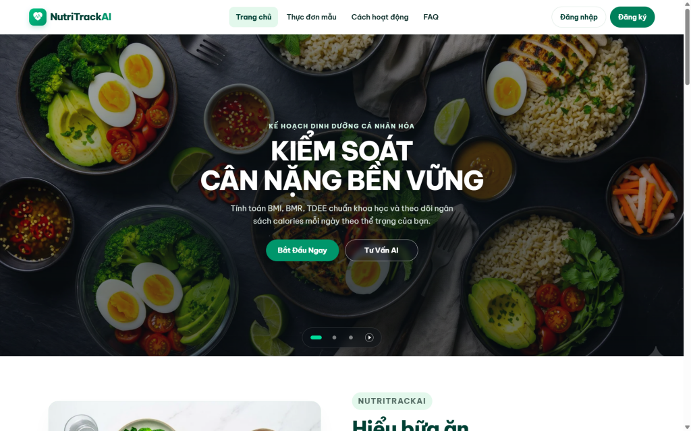

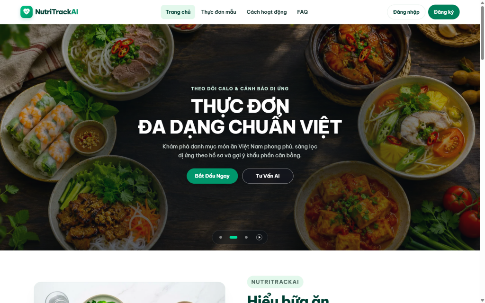

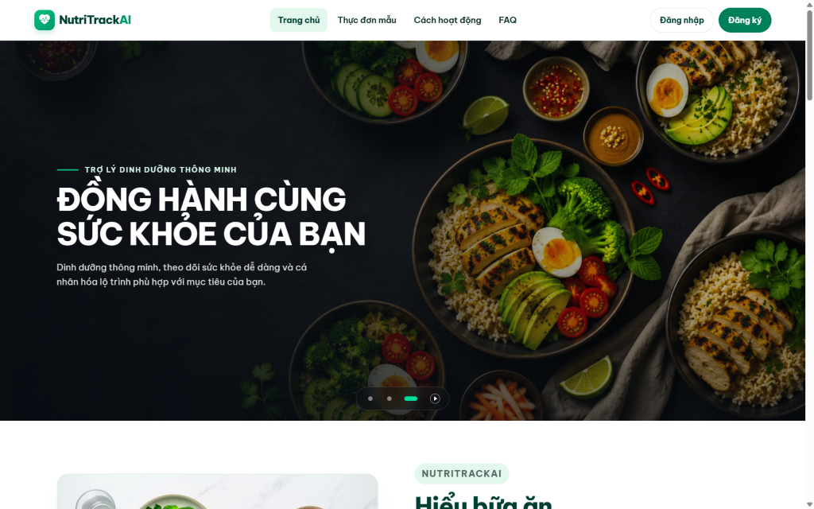

---

### 3.2. Section Giới thiệu: "Hiểu bữa ăn, theo dõi mục tiêu"

- Bố cục 2 cột cân bằng giữa ảnh bữa ăn lành mạnh tỷ lệ `1:1` bên trái (sắc nét, không bị bất kỳ thẻ nổi nào che khuất) và khối thông tin bên phải.
- Thanh ghi chú cá nhân hóa dùng viền nhấn trái tinh tế (`border-left: 3px solid var(--home-emerald)`).
- Khối dữ liệu `.home-intro-data` tách 2 tầng rõ ràng: thanh ngang 3 chỉ số cốt lõi (`Chỉ số BMI` · `BMR / TDEE` · `Cân bằng calo ngày` — không bị rớt chữ lẻ dòng) đặt trên 3 thẻ số liệu thực từ CSDL (`202+ Món ăn trong danh mục`, `10+ Bài tập có chỉ số MET`, `Theo hồ sơ — Lọc dị ứng an toàn`).

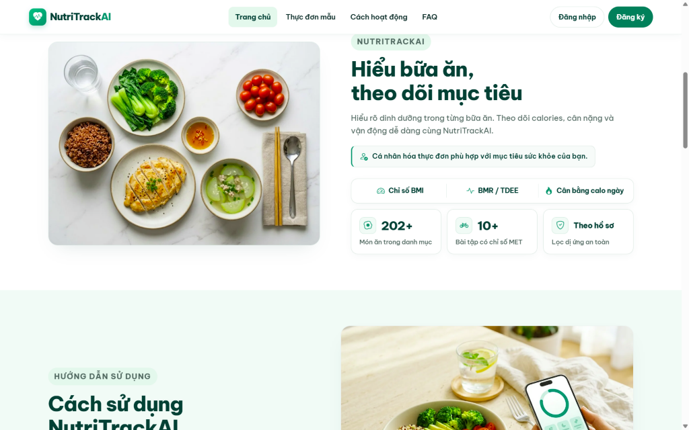

---

### 3.3. Section "Cách sử dụng NutriTrackAI" (`#cach-su-dung`) — Bố cục Biên tập 2 Tầng

- **Tầng 1**: Cột trái trình bày nhãn `HƯỚNG DẪN SỬ DỤNG`, tiêu đề và lời dẫn; cột phải hiển thị ảnh lifestyle người dùng theo dõi khẩu phần bên bữa ăn ở tỷ lệ rộng `16:11`.
- **Tầng 2**: Trải ngang 4 bước (`01. Tạo hồ sơ cá nhân` → `02. Đặt mục tiêu cân nặng` → `03. Ghi món và khẩu phần` → `04. Hỏi trợ lý AI`) trên toàn chiều rộng container với huy hiệu biểu tượng nền trắng và đường nối ngang trực quan.
- **Tuân thủ nghiêm ngặt yêu cầu thiết kế**: Hoàn toàn không có nút `"Xem tổng quan"`, `"Bắt đầu ngay"` hay `"Tạo tài khoản"`.

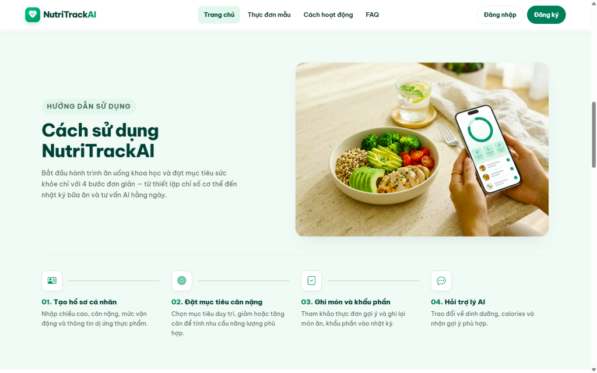

---

### 3.4. Section "Thực đơn mẫu tiêu biểu" (`#thuc-don-mau`)

- Lưới thích ứng thông minh: Hiển thị 2 cột lớn cân đối khi có 2 thực đơn mẫu công khai (và tự chuyển 3 cột khi có từ 3 thực đơn).
- Hệ thống phân cấp 7 lớp rõ ràng, không lặp lại con số calo: Ảnh món ăn tỷ lệ `16:10` → Nhãn mục tiêu + nhãn `Ảnh minh họa` → Tên thực đơn → Dòng năng lượng duy nhất `2.200 kcal/ngày` (`1.500 kcal/ngày`) → Đoạn mô tả 3 dòng đầy đủ → Chân thẻ gồm thông tin số món & đối chiếu dị ứng bên trái và liên kết `Xem chi tiết →` bên phải.

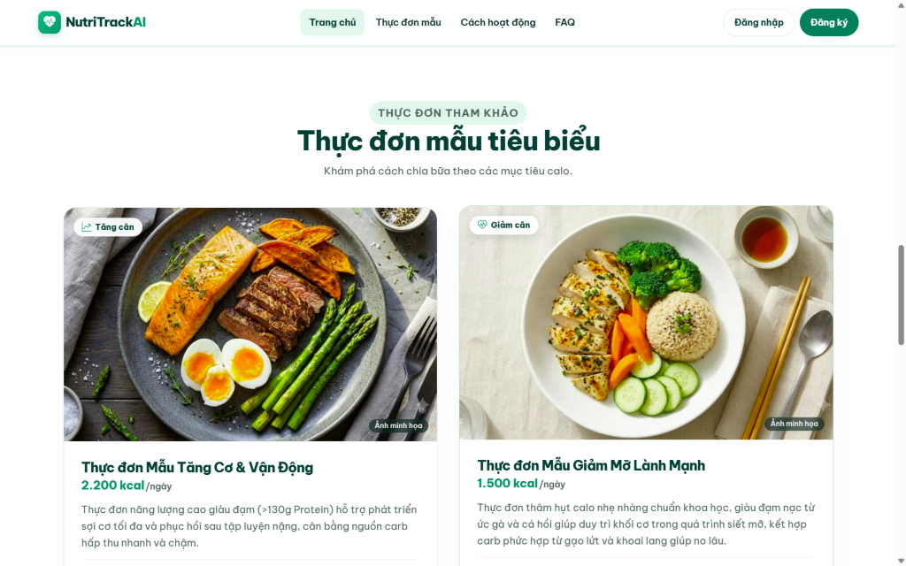

---

### 3.5. Section "Khoa học và an toàn" & "Câu hỏi thường gặp" (`#faq-section`)

- **Khoa học và an toàn**: Nền xám xanh dịu `#F5F8F6` với 3 thẻ đồng bộ chiều cao (*Dữ liệu Viện Dinh dưỡng & USDA*, *Sàng lọc dị ứng theo hồ sơ*, *Bảo vệ sức khỏe*).
- **Câu hỏi thường gặp (FAQ)**: Cột giới thiệu bên trái căn tĩnh tự nhiên cùng nút `Xem tất cả Kiến thức & FAQ →`; cột phải là danh sách Accordion dữ liệu động từ bảng `Articles`.

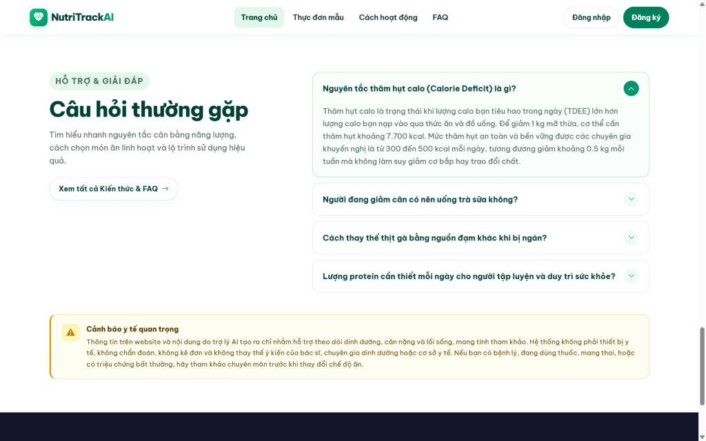

---

### 3.6. Cảnh báo Y tế Bắt buộc & Footer Tối màu (`#101828`)

- **Cảnh báo y tế (`#medical-disclaimer`)**: Đặt trong khung thông báo lâm sàng đơn lớp trang nhã (`#FFFCF3`, viền trái vàng hổ phách `3.5px`) trên nền trắng liền mạch, giữ **nguyên văn 100%** nội dung cảnh báo y tế bắt buộc của dự án.
- **Footer (`#101828`)**: Nền Navy tối với 3 cột cân đối (*NutriTrackAI*, *KHÁM PHÁ*, *AN TOÀN & CHÍNH SÁCH*).

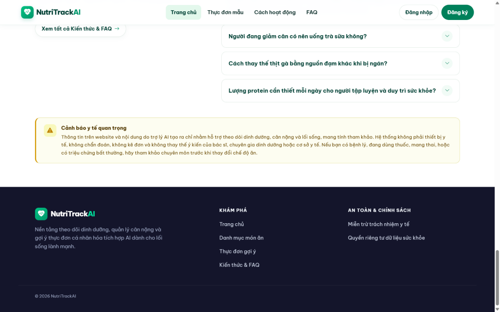

---

## 4. Thiết kế Responsive & Ảnh chụp Giao diện Mobile (`390px`)

Đã xác minh trên trình duyệt thực tế qua **8 kích thước màn hình** (`1920×1080`, `1440×900`, `1366×768`, `1024×768`, `768×1024`, `430×932`, `390×844`, `375×812`) với kết quả `horizontalOverflow = false` (`scrollWidth == innerWidth`) trên mọi độ phân giải.

| Hero & Giới thiệu Mobile (`390px`) | Cách sử dụng — Timeline dọc (`390px`) |
| :---: | :---: |
| 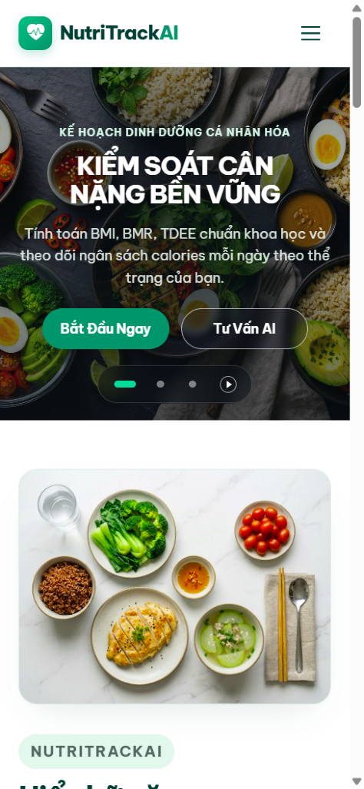 | 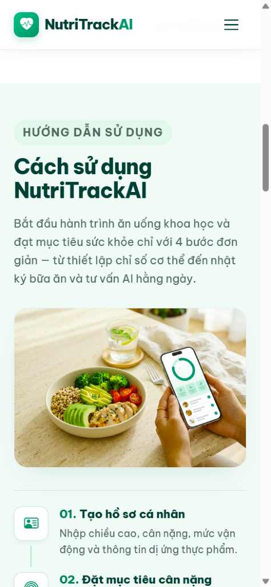 |

| Thẻ Thực đơn mẫu 1 (`390px`) | Thẻ Thực đơn mẫu 2 (`390px`) |
| :---: | :---: |
| 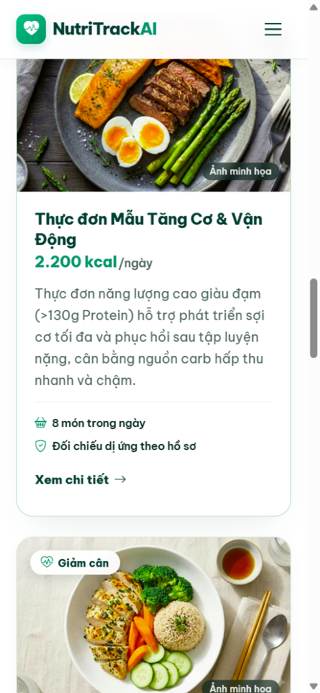 | 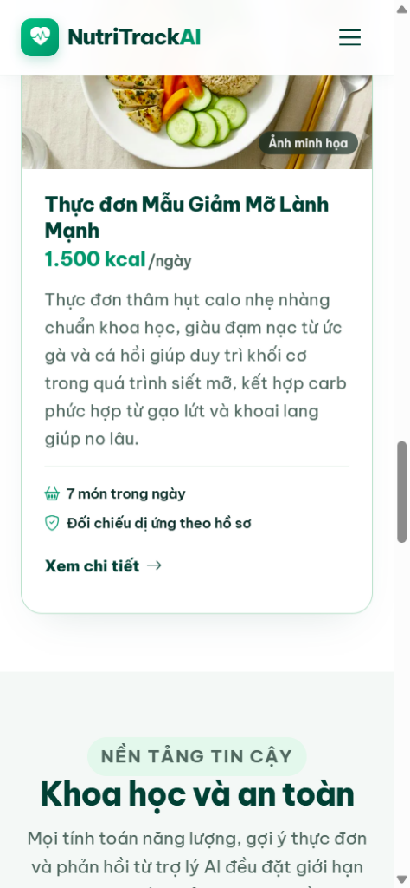 |

---

## 5. Ảnh chụp Toàn bộ Trang (Full-Page `1440px` & `390px`)

### 5.1. Toàn bộ Landing Page ở độ rộng `1440px` (`1440 × 4870 px`)

- Đường dẫn file: [`wwwroot/images/landingpage/after-landing-1440px-full.png`](../wwwroot/images/landingpage/after-landing-1440px-full.png)

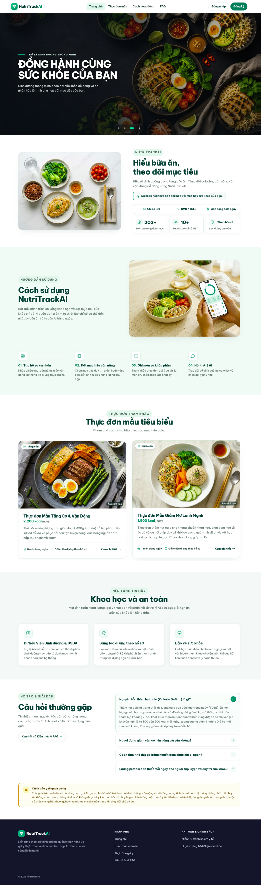

---

### 5.2. Toàn bộ Landing Page ở độ rộng `390px` (`390 × 7032 px`)

- Đường dẫn file: [`wwwroot/images/landingpage/after-landing-390px-full.png`](../wwwroot/images/landingpage/after-landing-390px-full.png)

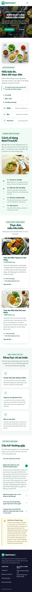

---

## 6. Tổng hợp Danh sách File Thay đổi & Tối ưu Tài nguyên

### 6.1. Mã nguồn Giao diện & Kiểm thử
- [`Views/Home/Index.cshtml`](../Views/Home/Index.cshtml): Cấu trúc HTML ngữ nghĩa toàn bộ Landing Page, `<picture>` ưu tiên `.webp`, điều hướng thông minh nút `"Bắt Đầu Ngay"` theo trạng thái đăng nhập (`startActionHref`), xử lý slideshow và cuộn neo Mobile.
- [`Views/Shared/_Layout.cshtml`](../Views/Shared/_Layout.cshtml): Tích hợp `.home-skip-link`, chuẩn hóa `<header class="home-header sticky-top">`, Cảnh báo y tế và Footer tối màu riêng cho Landing Page.
- [`wwwroot/css/site.css`](../wwwroot/css/site.css): Hệ thống Design System `.home-landing`, bố cục 2 tầng *Cách sử dụng*, thẻ *Thực đơn mẫu*, quy tắc ẩn/hiện `.home-skip-link:focus-visible`, hiệu ứng `prefers-reduced-motion` và responsive đa thiết bị.
- [`NutriTrackAI.Tests/WorkflowTests.cs`](../NutriTrackAI.Tests/WorkflowTests.cs): Cập nhật bài kiểm thử `HomeHero_ShowsRequestedActionsOnFirstTwoSlides` xác minh liên kết nút `"Bắt Đầu Ngay"` cho cả 3 trạng thái Khách (`/Account/Register`), Thành viên (`/Dashboard`) và Quản trị viên (`/Admin/Dashboard`).

### 6.2. Tài nguyên Hình ảnh & Ảnh chụp Nghiệm thu
- Ảnh minh họa và bộ ảnh nén `.webp` (giảm dung lượng ảnh Hero Slide 3 từ `2.780 KB` xuống `240 KB`):
  - [`wwwroot/images/hero-1.webp`](../wwwroot/images/hero-1.webp), [`wwwroot/images/hero-2.webp`](../wwwroot/images/hero-2.webp)
  - [`wwwroot/images/home/hero-3-slate.webp`](../wwwroot/images/home/hero-3-slate.webp), [`wwwroot/images/home/about-healthy.webp`](../wwwroot/images/home/about-healthy.webp)
  - [`wwwroot/images/home/workflow-lifestyle.jpg`](../wwwroot/images/home/workflow-lifestyle.jpg), [`wwwroot/images/home/workflow-lifestyle.webp`](../wwwroot/images/home/workflow-lifestyle.webp)
  - [`wwwroot/images/home/plan-1.webp`](../wwwroot/images/home/plan-1.webp), [`wwwroot/images/home/plan-2.webp`](../wwwroot/images/home/plan-2.webp), [`wwwroot/images/home/plan-3.webp`](../wwwroot/images/home/plan-3.webp)
- Bộ 14 ảnh chụp màn hình nghiệm thu lưu tại [`wwwroot/images/landingpage/`](../wwwroot/images/landingpage/).

### 6.3. Các thành phần nghiệp vụ được bảo toàn 100%
- Không thay đổi bất kỳ Controller, Service, Filter, Entity, ViewModel, Migration, cấu trúc CSDL SQL Server, cơ chế xác thực Identity hay thuật toán BMI / BMR / TDEE / Thực đơn / Chatbot AI nào.

---

## 7. Kết quả Kiểm thử Nghiệm thu Cuối cùng (Build, Unit Tests & Live Browser QA)

- **Biên dịch Release**:
  `dotnet build NutriTrackAI.csproj -c Release --no-restore --nologo` → **`0 Warning(s), 0 Error(s)`**.
- **Bộ kiểm thử tự động (`NutriTrackAI.Tests`)**:
  `dotnet test NutriTrackAI.Tests/NutriTrackAI.Tests.csproj -c Release --no-restore --nologo` → **`Passed: 243 / 243, Failed: 0, Skipped: 0`**.
- **Bảng tổng hợp nghiệm thu trực tiếp trên trình duyệt (`http://localhost:5188`)**:

| STT | Tiêu chí nghiệm thu | Kết quả đo thực tế | Đánh giá |
| :-: | :--- | :--- | :---: |
| 1 | Navbar sticky khi cuộn trang | Giữ cố định tại `top = 0px`, `height = 72px` ở cả trạng thái Khách và Đã đăng nhập | **Đạt** |
| 2 | Skip-link *"Chuyển đến nội dung chính"* | Ẩn hoàn toàn mặc định (`opacity: 0`), chỉ hiển thị khi nhấn `Tab` (`:focus-visible`) và nhảy đúng tới `#main-content` | **Đạt** |
| 3 | Nút *"Bắt Đầu Ngay"* khi đã đăng nhập | Chuyển hướng chính xác sang `/Dashboard` (`HTTP 200`) với User và `/Admin/Dashboard` với Admin | **Đạt** |
| 4 | Hoạt động của cả 3 Slide Hero | Slide 1 & 2 có đủ 2 nút hành động; Slide 3 căn trái không có nút CTA; chấm chuyển và nút Tạm dừng/Tiếp tục chuẩn xác | **Đạt** |
| 5 | Toàn bộ liên kết & tương tác | Neo `#thuc-don-mau`, `#cach-su-dung`, `#faq-section`, `#medical-disclaimer`, FAQ Accordion và 10 đường dẫn trang đều đạt `HTTP 200`, `0` lỗi Console | **Đạt** |
| 6 | Section *"Cách sử dụng"* không có CTA thừa | Giữ thuần vai trò giới thiệu 4 bước, `0` nút CTA | **Đạt** |
| 7 | Cảnh báo y tế bắt buộc | Hiển thị nguyên văn 100% ở cuối trang ngay trên Footer | **Đạt** |
| 8 | Quản lý Git & Checkpoint `667c1ba` | Nhánh `main` giữ nguyên tại `667c1ba`; mọi thay đổi nằm gọn trên `feature/landing-page-ui-redesign` | **Đạt** |
